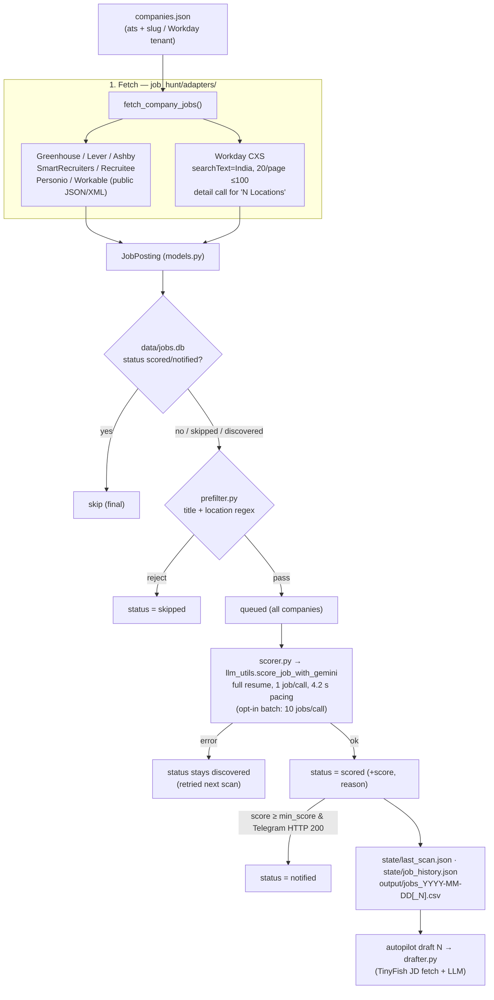

# System Architecture

Architecture guide for `autopilot-jobhunt` / **JobNotify**, a personal job radar for one
candidate (Manish Singh: 3 YOE, Node.js / backend / distributed systems, India or remote).
It is a fork of `tarunlnmiit/autopilot-jobhunt` that is **never upstreamed**, so
candidate-specific choices (e.g. the pre-filter) are deliberate. Read this together with
[CLAUDE.md](CLAUDE.md) before changing anything.

> ⚠️ **Invariant — drafts only.** Nothing in this project may ever submit an application.
> All outputs are CSVs and drafts in `output/` for human review.

---

## 1. Pipeline at a glance



Companies with no `ats` field fall back to the legacy TinyFish careers-page path in
`scanner.py` (only if `TINYFISH_API_KEY` is set). The current `companies.json` has none.

---

## 2. Components

| Module | Responsibility |
|---|---|
| [`adapters/`](job_hunt/adapters/) | One fetcher per ATS returning `JobPosting`s; `detect_ats()` from URLs; `fetch_company_jobs()` dispatch. 404 → `[]`, never raises. |
| [`adapters/workday.py`](job_hunt/adapters/workday.py) | CXS `POST …/wday/cxs/{tenant}/{site}/jobs` with `searchText="India"`, offsets 0–80 (Workday caps pages at 20), stop on a short page, keep earlier pages if a later one fails. Items showing `"N Locations"` get one `GET …{externalPath}` detail call for real locations + description. |
| [`models.py`](job_hunt/models.py) | `JobPosting` dataclass; `canonical_hash(title, company, location)` (MD5) is the dedupe key. |
| [`db.py`](job_hunt/db.py) | SQLite `data/jobs.db`, table `jobs`: `init_db`, `get_job`, `save_job`, `update_job_status`. Location is **not** stored. |
| [`prefilter.py`](job_hunt/prefilter.py) | Local, word-bounded regexes (see §3). No network. |
| [`scorer.py`](job_hunt/scorer.py) | Scores one job via Gemini (`raise_on_error=True`), sleeps 4.2 s (15 RPM), writes status/score, sends the optional Telegram alert. |
| [`llm_utils.py`](job_hunt/llm_utils.py) | Provider dispatch: `gemini` (default), `anthropic`, `claude_cli`; `openrouter` is deprecated and logs a warning. Gemini model fallbacks on 429/503. |
| [`scanner.py`](job_hunt/scanner.py) | `run_scan()` orchestration, state files, CSV export, scan-level Telegram digest. |
| [`notifier.py`](job_hunt/notifier.py) | `send_telegram`, `is_telegram_configured` (empty/placeholder ⇒ off), `format_job_alert` with headcount badge. |
| [`exporter.py`](job_hunt/exporter.py) | CSV writer that never overwrites (`jobs_DATE.csv`, `jobs_DATE_1.csv`, …). |
| [`discovery.py`](job_hunt/discovery.py) | `autopilot discover` (`--add-file` for pasted lists in any format): name → slug candidates → probe 7 ATSs (+ curated Workday tenants) → accept only boards with live jobs, confirmed identity, ≥1 India job, newest posting ≤180 days; `--merge` re-verifies existing entries. Seeds in `scripts/company_seeds.txt`. |
| [`harvester.py`](job_hunt/harvester.py) | Builds a company list from `india.yml`: probes the declared ATS first, then the other 6; active = HTTP 200 **and** ≥1 job; tags off-declared matches `ats_fallback_from`. Applies `validator.KNOWN_CORRECTIONS`. Headcount is metadata only. |
| [`validator.py`](job_hunt/validator.py) | `autopilot validate` pruner. Caveat: its probe accepts HTTP 200 with 0 jobs and it auto-adds BrowserStack — prefer `harvest` + manual diff. |
| [`company_builder.py`](job_hunt/company_builder.py) | LinkedIn headcount matching (`match_headcount`). Its `build_companies_dataset` / blocklist is legacy and not used by the CLI. |
| [`doctor.py`](job_hunt/doctor.py) | `autopilot doctor`: SQLite write, Gemini 1-token call, Telegram `getMe`, ATS egress. |
| [`drafter.py`](job_hunt/drafter.py) | `autopilot draft N|URL`: TinyFish JD fetch → tailored resume, cover letter, application info. Requires `TINYFISH_API_KEY`. |
| [`main.py`](job_hunt/main.py) | CLI (`init doctor validate harvest scan draft export mcp`) and `load_config()`. `config.py` re-exports it. |
| [`tools.py`](job_hunt/tools.py) / [`mcp_server.py`](job_hunt/mcp_server.py) | Protocol-agnostic tool layer and FastMCP server (`scan_jobs`, `draft_application`, `export_jobs`). |
| [`run_daily.sh`](run_daily.sh) | Cron runner: timestamps every line into `data/scan.log`, defaults `MIN_SCORE=70`. |

---

## 3. Key rules

### Pre-filter (`prefilter.py`)
Applied in order; all patterns are case-insensitive and word-bounded.

1. **Title exclude** — seniority (`senior`, `sr`, `lead`, `principal`, `staff`, `manager`, `director`, `architect`), other stacks (`java`, `python`, `golang`, `.net`, `c#`, `react`, `angular`, `vue`, `ios`, `android`, `flutter`, `frontend`), `qa`/`test(er|ing)`, `intern(ship)`, `devops`, `sre`. `java` does not match "JavaScript"; `test` does not match "Latest".
2. **Title include** — `backend`/`back-end`, `node`/`nodejs`, `sde\d*`, `software engineer`, `developer`, `full-stack`, `api`, `distributed systems`, `platform|product|infrastructure|systems engineer`.
3. **Location**
   - an Indian city (incl. Delhi/NCR/Kolkata), `india`, or a trailing lowercase `, in`
     country code ⇒ pass (even alongside US cities; uppercase `, IN` = Indiana is not India);
   - else a non-India region (`us`, `uk`, `canada`, `germany`, `europe`, `emea`, `latam`, major US/EU cities, `, CA|NY|TX|WA|IL|MA`) ⇒ reject;
   - else `worldwide|anywhere|global` ⇒ pass;
   - else `is_remote` or `remote` ⇒ pass (geography-free remote);
   - else reject.
4. **Posted date (optional)** — with `--posted-within N` / `candidate.max_posted_age_days`,
   jobs whose posted date is known and older than N days are saved as `skipped`; undated
   jobs always pass. Dates: ISO from Greenhouse (`first_published`), Lever, Ashby,
   SmartRecruiters, Workable, Recruitee, Personio; Workday relative text ("Posted 5 Days Ago").

### DB status lifecycle

| status | meaning | next scan |
|---|---|---|
| `skipped` | rejected by pre-filter | re-run through the pre-filter, so filter changes apply retroactively |
| `discovered` | passed the pre-filter, not yet scored, **or scoring failed** | re-scored |
| `scored` | Gemini score stored | final |
| `notified` | scored **and** Telegram returned HTTP 200 | final |

A Gemini failure never writes `score=0`. Telegram is optional: with empty/placeholder
credentials it is skipped (debug log) and jobs stay `scored`.

### Configuration precedence
Module defaults → `config.json` → `.env` (an env value is ignored if it is a placeholder
such as `YOUR_…` / `…_here`). `llm_provider` defaults to `gemini`, `gemini_model` to
`gemini-3.5-flash-lite`. `TELEGRAM_BOT_TOKEN` is an alias of `TELEGRAM_TOKEN`.

---

## 4. State and storage

| Path | Purpose | Git |
|---|---|---|
| `companies.json` | Curated ATS boards (see CLAUDE.md for removed boards and why) | committed |
| `config.json`, `.env` | Candidate profile, provider, keys | ignored |
| `resume/YOUR_RESUME.md` | Resume template (committed); real resume via `candidate.resume_path` | template only |
| `data/jobs.db`, `data/scan.log` | Dedupe DB, cron log | ignored |
| `state/last_scan.json`, `state/job_history.json`, `state/seen_jobs.json` | Last scan, cumulative history (for `export --days`), legacy URL set | ignored |
| `output/` | CSVs and drafts | ignored |

---

## 5. Development standards

```bash
uv venv --python 3.12 && source .venv/bin/activate
uv pip install -e ".[dev,mcp,claude]"
pytest            # coverage gate 85% (pyproject)
ruff check job_hunt
mypy
```

- **No network in tests.** Stub adapters (`requests.get/post`), Gemini
  (`score_job_with_gemini` / `_get_genai_client_and_types`), and `scanner.send_telegram`.
  Use the `clean_env` / `fake_llm` fixtures in [`conftest.py`](conftest.py).
- **Test-first** for behaviour changes; update [`CHANGELOG.md`](CHANGELOG.md) under `[Unreleased]`.
- New capabilities go into `tools.py` first so the CLI and MCP stay in parity.

---

## 6. Known limitations (measured 2026-10-03/04)

- **Workday scan time:** detail calls for multi-location jobs cost ~100 s each for Nvidia
  and Salesforce; a full Workday pass is ~5 min.
- **Volume is title-bound:** of 455 Workday jobs (301 India), 7 passed the pre-filter;
  Target/BrowserStack India roles are mostly non-engineering or senior.
- **Walmart Workday** (`walmart/wd5/WalmartExternal`) returns HTTP 422; not in the list.
- **Scan length:** companies are fetched 8 at a time (measured 6.4 min for 139 boards on
  2026-10-04 vs ~45 min sequential). Every HTTP call has a 900 s total deadline and Workday
  tenants a 600 s budget; a board that exceeds it is skipped for that scan (logged as a warning).
- **Batch scoring is opt-in only:** measured mean |Δ| of 15.5 points vs single-job scores
  (noise 1.0); weak fits inflated. Single-job scoring costs ~4.2 s per new job.
- **SmartRecruiters** list API has no descriptions (title-only scoring) and the adapter
  stops at 100 postings (Freshworks, Swiggy hit the cap).
- **Harvest is not idempotent with the curated list:** rerunning it re-adds boards removed on
  evidence (wrong employer on a same-slug board). Harvest to a scratch file and diff.
- Workday jobs without multi-location get no description, so Gemini scores them on title.

---

## 7. Roadmap

Done: direct ATS adapters (8 engines), SQLite dedupe, Gemini scoring, Workday India search
+ pagination, optional Telegram, curated India company list.

Next candidates:
- Config-driven pre-filter (move the regexes into `config.json`).
- Additional notification channels (Slack/Discord/email digest).
- Multi-dimensional scoring (stack / seniority / location) and salary parsing.
- Local web dashboard for reviewing CSVs, drafts and application status.
- Interview-prep and company-dossier generators (drafts only).
