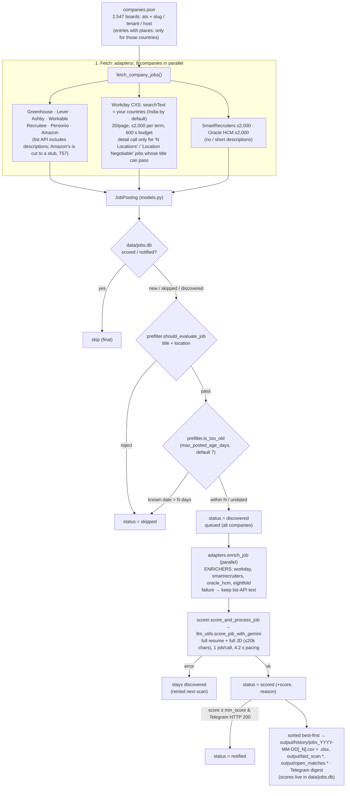

# System Architecture

How RoleSight is built. RoleSight is a job radar tuned for one candidate by default (Manish Singh:
3 YOE, Node.js / backend / distributed systems, India or remote); [docs/00-user-guide.md](docs/00-user-guide.md)
says what to change to tune it to someone else. It started from `tarunlnmiit/autopilot-jobhunt` (MIT) and is a
separate project now, not kept in step with that one, so candidate-specific choices (the hardcoded pre-filter, the
India company list) are deliberate defaults. Read this together with [CLAUDE.md](CLAUDE.md) and the task board
[docs/tasks.md](docs/tasks.md) before changing anything.

> ⚠️ **Invariant: drafts only.** Nothing in this project may ever submit an application or
> fill in a form. All outputs are CSV/Excel files and draft files in `output/` for a human to review.

Current as of 2026-10-04, after T47 (Workday paging), T30 (dedupe by ATS id) and T24.

---

## 1. Pipeline at a glance



A company whose `careers_url` names a known ATS is detected automatically; one with no
supported ATS is skipped with a warning (custom careers pages are not scanned). The old
TinyFish careers-page path was removed (T42).

---

## 2. Components

| Module | Responsibility |
|---|---|
| [`adapters/__init__.py`](job_hunt/adapters/__init__.py) | `detect_ats(url)` (Greenhouse incl. EU and embed URLs, Lever, Ashby, SmartRecruiters, Workday incl. locale paths, Oracle HCM, Recruitee, Personio, Workable); `fetch_company_jobs(entry)` dispatch, which applies the entry's `name` and `headcount`; `ENRICHERS` and `enrich_job(job)` (never raises). |
| [`adapters/base.py`](job_hunt/adapters/base.py) | `http_get` / `http_post` with a **900 s total download deadline** (requests' `timeout` is per read, and Lever boards were seen trickling for 100–436 s); `strip_html` (stdlib only; decodes Greenhouse's entity-escaped markup). |
| `adapters/<ats>.py` | One fetcher per ATS returning `JobPosting`s; endpoints and limits in [docs/04](docs/04-companies-and-scanning.md#per-ats-fetching). Errors are logged as warnings and give `[]`. `workday`, `smartrecruiters` and `oracle_hcm` also expose `fetch_description(job)` for the enrich step. |
| [`models.py`](job_hunt/models.py) | `JobPosting` (`global_id`, `ats`, `company`, `title`, `location`, `is_remote`, `url`, `description_text`, `posted_at`, `headcount`); `job_key(job)` is the dedupe key: the ATS's `global_id`, else `canonical_hash(title, company, location)` (MD5). |
| [`db.py`](job_hunt/db.py) | SQLite `data/jobs.db`, table `jobs`: `init_db`, `get_job`, `save_job`, `update_job_status`, `get_jobs_by_status`. Location, posted date and (for queued jobs) the description are stored (T29). |
| [`places.py`](job_hunt/places.py) | Where the person looks (T136–T142): `candidate.countries` / `home_country` → `Places`; a `Country` pack for every country (nine hand-made, the rest from `job_hunt/data/countries.json`, GeoNames); `explicit_countries(part)` (names, codes, US/CA/AU states and provinces) and the rule that a city counts unless what qualifies it names another country; `configure_places` / `active_places` / `using` (per thread, for `discover`'s recheck); `listed_for` (which `companies.json` entries a scan fetches). India alone keeps every original rule. |
| [`visa.py`](job_hunt/visa.py) | The Visa column (T138): `wording` (what a posting says about sponsorship, T133's patterns), `record` (the company's entry in `job_hunt/data/visa_sponsors.json` for a country), `note` (both, for a job outside the home country). |
| [`prefilter.py`](job_hunt/prefilter.py) | `should_evaluate_job` (title exclude → title include → location: India's rules, or `_in_your_places` for other countries) and `is_too_old` / `posted_age_days` (ISO, epoch, Workday relative text). Local and deterministic. Rules in [docs/07](docs/07-config-and-scoring.md#the-pre-filter-titles-configjson-candidatetitles-places-job_huntprefilterpy). |
| [`scanner.py`](job_hunt/scanner.py) | `run_scan()`: parallel fetch (`fetch_workers`) → per-job dedupe / pre-filter / age → enrich → score → state files, CSV, digest. Also `score_jobs`, the batch prompt used by the non-Gemini providers. |
| [`scorer.py`](job_hunt/scorer.py) | `score_and_process_job` (single, default) / `score_and_process_batch` (opt-in): Gemini call, 4.2 s pacing, DB status update, per-job Telegram alert. A failure returns `score=None` and leaves the row `discovered`. |
| [`llm_utils.py`](job_hunt/llm_utils.py) | `configure_rubric` (the rubric text; with other countries rule 1 and rule 5's location line rewritten by `rubric_for_places`, T138); `score_job_with_gemini` / `score_jobs_batch_with_gemini` (JSON output, model fallback `gemini-3.5-flash-lite` → `gemini-3.1-flash-lite`, one retry per model on 429/503/quota; a model whose daily quota is gone is skipped until its reset, T64); `chat_with_llm` provider dispatch for drafting (`gemini`, `anthropic`, `claude_cli`; `openrouter` was removed). |
| [`exporter.py`](job_hunt/exporter.py) | CSV writer: 11 columns in reading order (Score first), optional ones only when filled (Visa for a job outside the home country, T138), never overwrites (`output/history/jobs_DATE.csv`, `jobs_DATE_1.csv`, …); where the files go: `HISTORY_DIR`. |
| [`xlsx_report.py`](job_hunt/xlsx_report.py) | The formatted Excel copy written beside each CSV (T128): frozen header, filter, coloured Score, wrapped text, links. Built from the CSV; a failure only logs a warning. |
| [`notifier.py`](job_hunt/notifier.py) | `send_telegram`, `is_telegram_configured` (empty or placeholder ⇒ off), `format_job_alert` (with the headcount badge, and a Visa line for a job abroad, T140). |
| [`discovery.py`](job_hunt/discovery.py) | `autopilot discover`: seeds / `--add-file` / `--add` → slug candidates → probe ATSs and curated Workday tenants → accept only if live, the right employer, ≥1 job in the places checked (India, or `--places` / `candidate.countries`; such entries record `places`, T139) and the newest posting ≤180 days; `--merge`, `--recheck`, `--census`, `--emit-seeds`. `KNOWN_BAD_BOARDS` is never accepted. |
| [`harvester.py`](job_hunt/harvester.py), [`validator.py`](job_hunt/validator.py), [`company_builder.py`](job_hunt/company_builder.py) | Older list builders. `validate` **rewrites `companies.json` in place**; `harvest` writes there by default but refuses to overwrite an existing file without `--force` (T43). Use `discover`. `company_builder.match_headcount` is still used by `discover` for the badge. |
| [`doctor.py`](job_hunt/doctor.py) | `autopilot doctor`: SQLite write, a 1-token Gemini call, Telegram `getMe`, ATS egress. |
| [`drafter.py`](job_hunt/drafter.py) | `autopilot draft N\|URL [--jd-file F]`: reads the job description stored in the database (T29/T40) → tailored resume, cover letter, application info in `output/drafts/<company>-<date>/`. |
| [`main.py`](job_hunt/main.py) | CLI (`init doctor validate harvest discover scan draft export mark schedule mcp`) and `load_config()`; `config.py` re-exports it. |
| [`scheduler.py`](job_hunt/scheduler.py) | `autopilot schedule on / off / status` (T121): the daily scan as a systemd user timer (`scripts/systemd/install.sh`) or one marked crontab line; off by default, `off` removes what `on` wrote. |
| [`tools.py`](job_hunt/tools.py) / [`mcp_server.py`](job_hunt/mcp_server.py) | Protocol-agnostic tool layer and FastMCP stdio server (`scan_jobs`, `draft_application`, `export_jobs`). |
| [`run_daily.sh`](run_daily.sh) | Runner: timestamps every output line into `data/scan.log`, sets no `min_score` of its own (it comes from `config.json`, default 70, T05). Scheduled only when the person runs `autopilot schedule on` (T121; default off). |

---

## 3. Key rules

### Dedupe and the status lifecycle

| status | meaning | next scan |
|---|---|---|
| `skipped` | Rejected by the pre-filter, or outside the posted-date window | Re-run through the pre-filter and the age check, so rule changes apply retroactively |
| `discovered` | Passed, not yet scored, **or scoring failed** | Scored again |
| `scored` | Gemini score stored | Final |
| `notified` | Scored **and** Telegram returned HTTP 200 | Final |

A Gemini failure never writes `score=0`. Each posting is keyed by `(ats, global_id)`, the
ATS's own id, so two openings with the same title and location are two rows (T30). Rows
without a `global_id` fall back to `canonical_hash(title, company, location)`.

### Ordering

`run_scan` sorts the scored jobs best first before writing the CSV; `draft N` reads the same order from
`data/jobs.db` (T31). Digest #N = `draft N` = CSV row N (T10).

### Configuration precedence

Module defaults → `config.json` → `.env` (`load_dotenv(override=True)`, which also beats
the shell's environment). An env value is ignored if it's a placeholder (`YOUR_…`,
`…_here`). `llm_provider` defaults to `gemini`. **Scoring uses Gemini whenever a Gemini key
is present**, whatever `llm_provider` says; `llm_provider` only picks the drafting
model and the legacy no-key path.

---

## 4. State and storage

| Path | Purpose | Git |
|---|---|---|
| `companies.json` | Curated ATS boards (the core asset) | committed |
| `scripts/company_seeds.txt`, `scripts/careers_urls.txt` | `discover` seeds and census input | committed |
| `config.json`, `.env` | Candidate profile, provider, keys | ignored |
| `resume/*.md` | Real resume (`candidate.resume_path`); only `YOUR_RESUME.md` is committed | ignored |
| `data/jobs.db` | Seen-job store | ignored |
| `data/scan.log` | `run_daily.sh` output | ignored |
| `data/autopilot.log` | Full DEBUG log of every command (`autopilot` and `job_hunt.*` loggers); rotates at 5 MB, keeps 3 older files; `ROLESIGHT_LOG` overrides the path | ignored |
| `scan.log` | Where this log lived before T16 (root dir, unrotated); no longer written | ignored |
| `state/*.json` | Retired (T34): no longer written or read; `scripts/import_json_history.py` imports scores only they hold | ignored |
| `output/` | `open_matches.*` and `last_scan.*` (fixed names, replaced every scan), `history/` (dated files), `drafts/` (T130) | ignored |
| `job_hunt/data/` | Templates that `autopilot init` copies, including a copy of the curated `companies.json` (a test checks they match; T50) | committed |

---

## 5. Concurrency, limits and pacing

| Thing | Value | Where |
|---|---|---|
| Companies fetched in parallel | 8 (`fetch_workers`) | `scanner.DEFAULT_FETCH_WORKERS` |
| Total deadline per HTTP response | 900 s | `adapters/base.DOWNLOAD_DEADLINE_SECONDS` |
| Workday budget per tenant | 600 s; ≤2,000 jobs, 20 per page | `adapters/workday.py` |
| SmartRecruiters / Oracle HCM / Amazon caps | 2,000 / 2,000 / 4,000 jobs | adapter `MAX_JOBS` |
| Enrich step | parallel, `fetch_workers` threads, survivors only | `scanner._enrich_jobs` |
| Gemini pacing | 4.2 s after each call (15 RPM) | `scorer.THROTTLE_INTERVAL_SECONDS` |
| Description bound in the prompt | 20,000 chars | `llm_utils.MAX_DESCRIPTION_CHARS` |
| `discover` probes in parallel | 40 (`--workers`) | `discovery.main` |

DB writes and scoring are sequential.

---

## 6. Development standards

```bash
python3 -m venv .venv && source .venv/bin/activate
pip install -e '.[gemini,dev,mcp]'
pytest            # coverage gate 85% (pyproject)
ruff check job_hunt/ tests/ conftest.py
mypy
```

- **No network in tests.** Stub adapters (`requests.get/post` or `adapters.base.http_*`),
  Gemini (`score_job_with_gemini` / `_get_genai_client_and_types`), and
  `scanner.send_telegram`. `conftest.py` stubs `scanner.enrich_job` globally and provides
  the `clean_env` / `fake_llm` fixtures.
- **Test first** for behaviour changes. Record the change, with its measurement, in
  [`CHANGELOG.md`](CHANGELOG.md) under `[Unreleased]`.
- **Work comes from [docs/tasks.md](docs/tasks.md)**: claim → implement → review queue
  → verification.
- **Tool parity:** new capabilities go into `tools.py` first, so the CLI and MCP stay in
  step.

---

## 7. Known limitations

Measured on the date given. Each one has a task.

- **Scan time:** the first full scan (2026-10-04) took 34.3 min: 8.9 min fetching, 32 s enriching,
  about 24 min scoring 226 jobs at ~6.3 s each. A full fetch of 223 companies took 10.0 min on
  2026-10-07; daily scans only score new jobs.
- **Gemini quota:** 500 calls per model per day, reset at midnight Pacific (Google's docs; measured
  2026-10-07). A scan has no cap on the jobs it scores (T118; `max_jobs_to_score_per_run` is optional), newest first; when the
  first model has used its day the scan goes on with the second (a model out for the day is skipped until the reset, T64) and
  scoring stops when every model is out of quota (T03), leaving the rest for the next scan. **Model choice matters** (T70, 82 labelled jobs, two runs each): `gemini-3.1-flash-lite`
  ranks like `gemini-3.5-flash-lite` but scores weak fits ~8 points higher (10 vs 2 false positives at
  `min_score` 70), so a scan that falls back to 3.1 mixes two calibrations; which model scored a job
  is recorded with each score (`score_model`, T71), and so is the id of the rubric text (`score_rubric`, T97).
- **Score noise:** two runs of 3.5 differ by ~3 points on average. With the T73 rubric no pass/fail
  decision changed between two runs of all 82 labelled jobs; ambiguous postings can still flip, and
  temperature 0 does not help (T60).
- **Labels:** the 82 golden-set labels are Claude's except g27 (Manish's). Rubric results are only as
  good as the labels (T59).
- **Pre-filter recall** (measured 2026-10-07; jobs blocked before Gemini sees them): titles with
  "python" (9 of 32 score ≥ 80; decision T62) and "AI Engineer" / "Forward Deployed Engineer"
  (21 of 68 score ≥ 70 on 3.5; decision T74). Amazon's "Software Dev Engineer" spelling was blocked
  until T72 (33 of 56 score ≥ 80). Generic "Senior Engineer" / "Engineer II" titles are scored since T96
  (`generic_engineer_titles`); the title words are `config.json` `candidate.titles` since T103.
- **Onsite outside your countries:** "India anywhere in the location" passes multi-location jobs; the
  prompt caps roles that need onsite work abroad at 30 (rubric rule 1, T24). With `candidate.countries` set (T136–T140) the
  same holds for those countries, and rule 1 also caps postings that refuse visa sponsorship; a country without a built-in
  pack is matched by its name only, and postings in other languages do not match the English title words.
- **One store** since T31–T34: `data/jobs.db`. Scores held only by the retired `state/*.json` files need
  `scripts/import_json_history.py` once.
- **Unreachable employers:** custom portals and platforms without a public API (Darwinbox,
  Zoho Recruit…; Phenom mostly fronts Workday, T26). The census found 52% of 458 careers pages
  JS-only or unidentified.
- **Operations:** not scheduled unless the person runs `autopilot schedule on` (systemd user timer, else cron; T121, T07); Manish has not; the code is backed up on GitHub (T01); the database, resume and keys are not.

---

## 8. Roadmap

The roadmap is the task board, [docs/tasks.md](docs/tasks.md); what is still fixed to one setup (India first: T108) and the
ideas for extending RoleSight are in [docs/10-limitations-and-future-work.md](docs/10-limitations-and-future-work.md). Accuracy work (what Gemini
sees, how it scores, which jobs reach it) comes first; then scheduling and operations;
then a single SQLite source of truth, tracking features and cleanup.
