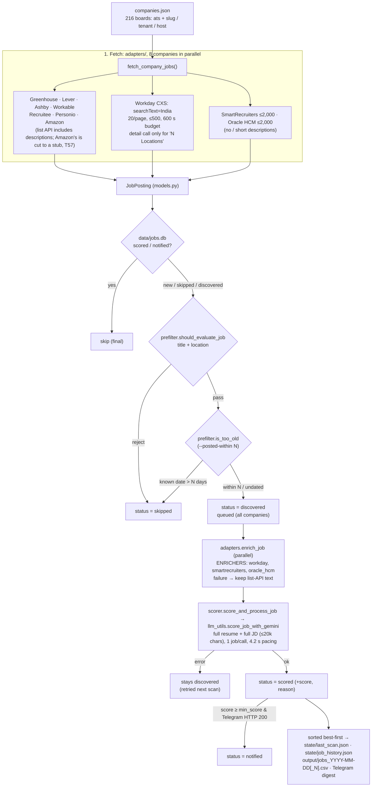

# System Architecture

How JobNotify is built. JobNotify is a personal job radar for one candidate (Manish Singh:
3 YOE, Node.js / backend / distributed systems, India or remote). It's a fork of
`tarunlnmiit/autopilot-jobhunt` that is **never upstreamed**, so candidate-specific choices
(the hardcoded pre-filter, the India company list) are deliberate. Read this together
with [CLAUDE.md](CLAUDE.md) and the task board [docs/tasks.md](docs/tasks.md) before
changing anything.

> ⚠️ **Invariant: drafts only.** Nothing in this project may ever submit an application or
> fill in a form. All outputs are CSVs and draft files in `output/` for a human to review.

Current as of 2026-10-04, after T47 (Workday paging), T30 (dedupe by ATS id) and T24.

---

## 1. Pipeline at a glance



A company whose `careers_url` names a known ATS is detected automatically; one with no
supported ATS is skipped with a warning (custom careers pages are not scanned). The old
TinyFish careers-page path was removed (T42).

---

## 2. Components

| Module | Responsibility |
|---|---|
| [`adapters/__init__.py`](job_hunt/adapters/__init__.py) | `detect_ats(url)` (Greenhouse incl. EU and embed URLs, Lever, Ashby, SmartRecruiters, Workday incl. locale paths, Oracle HCM, Recruitee, Personio, Workable); `fetch_company_jobs(entry)` dispatch, which applies the entry's `name` and `headcount`; `ENRICHERS` and `enrich_job(job)` (never raises). |
| [`adapters/base.py`](job_hunt/adapters/base.py) | `http_get` / `http_post` with a **900 s total download deadline** (requests' `timeout` is per read, and Lever boards were seen trickling for 100–436 s); `strip_html` (stdlib only; decodes Greenhouse's entity-escaped markup). |
| `adapters/<ats>.py` | One fetcher per ATS returning `JobPosting`s; endpoints and limits in [docs/04](docs/04-companies-and-scanning.md#per-ats-fetching). Errors are logged as warnings and give `[]`. `workday`, `smartrecruiters` and `oracle_hcm` also expose `fetch_description(job)` for the enrich step. |
| [`models.py`](job_hunt/models.py) | `JobPosting` (`global_id`, `ats`, `company`, `title`, `location`, `is_remote`, `url`, `description_text`, `posted_at`, `headcount`); `job_key(job)` is the dedupe key: the ATS's `global_id`, else `canonical_hash(title, company, location)` (MD5). |
| [`db.py`](job_hunt/db.py) | SQLite `data/jobs.db`, table `jobs`: `init_db`, `get_job`, `save_job`, `update_job_status`, `get_jobs_by_status`. Location, posted date and (for queued jobs) the description are stored (T29). |
| [`prefilter.py`](job_hunt/prefilter.py) | `should_evaluate_job` (title exclude → title include → location) and `is_too_old` / `posted_age_days` (ISO, epoch, Workday relative text). Local and deterministic. Rules in [docs/07](docs/07-config-and-scoring.md#the-pre-filter-job_huntprefilterpy). |
| [`scanner.py`](job_hunt/scanner.py) | `run_scan()`: parallel fetch (`fetch_workers`) → per-job dedupe / pre-filter / age → enrich → score → state files, CSV, digest. Also `score_jobs`, the batch prompt used by the non-Gemini providers. |
| [`scorer.py`](job_hunt/scorer.py) | `score_and_process_job` (single, default) / `score_and_process_batch` (opt-in): Gemini call, 4.2 s pacing, DB status update, per-job Telegram alert. A failure returns `score=None` and leaves the row `discovered`. |
| [`llm_utils.py`](job_hunt/llm_utils.py) | `score_job_with_gemini` / `score_jobs_batch_with_gemini` (JSON output, model fallback `gemini-3.5-flash-lite` → `gemini-3.1-flash-lite`, one retry per model on 429/503/quota); `chat_with_llm` provider dispatch for drafting (`gemini`, `anthropic`, `claude_cli`; `openrouter` was removed). |
| [`exporter.py`](job_hunt/exporter.py) | CSV writer: 11 columns, never overwrites (`jobs_DATE.csv`, `jobs_DATE_1.csv`, …). |
| [`notifier.py`](job_hunt/notifier.py) | `send_telegram`, `is_telegram_configured` (empty or placeholder ⇒ off), `format_job_alert` (with the headcount badge). |
| [`discovery.py`](job_hunt/discovery.py) | `autopilot discover`: seeds / `--add-file` / `--add` → slug candidates → probe ATSs and curated Workday tenants → accept only if live, the right employer, ≥1 India job and the newest posting ≤180 days; `--merge`, `--recheck`, `--census`, `--emit-seeds`. `KNOWN_BAD_BOARDS` is never accepted. |
| [`harvester.py`](job_hunt/harvester.py), [`validator.py`](job_hunt/validator.py), [`company_builder.py`](job_hunt/company_builder.py) | Older list builders. Both CLIs **write `companies.json` by default**; use `discover`. `company_builder.match_headcount` is still used by `discover` for the badge. |
| [`doctor.py`](job_hunt/doctor.py) | `autopilot doctor`: SQLite write, a 1-token Gemini call, Telegram `getMe`, ATS egress. |
| [`drafter.py`](job_hunt/drafter.py) | `autopilot draft N\|URL [--jd-file F]`: reads the job description stored in the database (T29/T40) → tailored resume, cover letter, application info in `output/<company>-<date>/`. |
| [`main.py`](job_hunt/main.py) | CLI (`init doctor validate harvest discover scan draft export mcp`) and `load_config()`; `config.py` re-exports it. |
| [`tools.py`](job_hunt/tools.py) / [`mcp_server.py`](job_hunt/mcp_server.py) | Protocol-agnostic tool layer and FastMCP stdio server (`scan_jobs`, `draft_application`, `export_jobs`). |
| [`run_daily.sh`](run_daily.sh) | Runner: timestamps every output line into `data/scan.log`, exports `MIN_SCORE=70` (which `.env` overrides, T05). Not scheduled yet (T07). |

---

## 3. Key rules

### Dedupe and the status lifecycle

| status | meaning | next scan |
|---|---|---|
| `skipped` | Rejected by the pre-filter, or outside the posted-date window | Re-run through the pre-filter and the age check, so rule changes apply retroactively |
| `discovered` | Passed, not yet scored, **or scoring failed** | Scored again |
| `scored` | Gemini score stored | Final |
| `notified` | Scored **and** Telegram returned HTTP 200 | Final |

A Gemini failure never writes `score=0`. Each posting is keyed by `(ats, global_id)`, the
ATS's own id, so two openings with the same title and location are two rows (T30). Rows
without a `global_id` fall back to `canonical_hash(title, company, location)`.

### Ordering

`run_scan` sorts the scored jobs best first before writing `state/last_scan.json` and the
CSV. Digest #N = `draft N` = CSV row N (T10).

### Configuration precedence

Module defaults → `config.json` → `.env` (`load_dotenv(override=True)`, which also beats
the shell's environment). An env value is ignored if it's a placeholder (`YOUR_…`,
`…_here`). `llm_provider` defaults to `gemini`. **Scoring uses Gemini whenever a Gemini key
is present**, whatever `llm_provider` says; `llm_provider` only picks the drafting
model and the legacy no-key path.

---

## 4. State and storage

| Path | Purpose | Git |
|---|---|---|
| `companies.json` | Curated ATS boards (the core asset) | committed |
| `scripts/company_seeds.txt`, `scripts/careers_urls.txt` | `discover` seeds and census input | committed |
| `config.json`, `.env` | Candidate profile, provider, keys | ignored |
| `resume/*.md` | Real resume (`candidate.resume_path`); only `YOUR_RESUME.md` is committed | ignored |
| `data/jobs.db` | Seen-job store | ignored |
| `data/scan.log` | `run_daily.sh` output | ignored |
| `data/autopilot.log` | Full DEBUG log of every command (`autopilot` and `job_hunt.*` loggers); rotates at 5 MB, keeps 3 older files; `JOBNOTIFY_LOG` overrides the path | ignored |
| `scan.log` | Where this log lived before T16 (root dir, unrotated); no longer written | ignored |
| `state/last_scan.json`, `state/job_history.json`, `state/seen_jobs.json` | Latest scan (best first), cumulative history, legacy URL set. They overlap with the DB (T31–T34) | ignored |
| `output/` | CSVs and drafts | ignored |
| `job_hunt/data/` | Templates that `autopilot init` copies. Its `companies.json` is an outdated upstream list (T50) | committed |

---

## 5. Concurrency, limits and pacing

| Thing | Value | Where |
|---|---|---|
| Companies fetched in parallel | 8 (`fetch_workers`) | `scanner.DEFAULT_FETCH_WORKERS` |
| Total deadline per HTTP response | 900 s | `adapters/base.DOWNLOAD_DEADLINE_SECONDS` |
| Workday budget per tenant | 600 s; ≤2,000 jobs, 20 per page | `adapters/workday.py` |
| SmartRecruiters / Oracle HCM / Amazon caps | 2,000 / 2,000 / 4,000 jobs | adapter `MAX_JOBS` |
| Enrich step | parallel, `fetch_workers` threads, survivors only | `scanner._enrich_jobs` |
| Gemini pacing | 4.2 s after each call (15 RPM) | `scorer.THROTTLE_INTERVAL_SECONDS` |
| Description bound in the prompt | 20,000 chars | `llm_utils.MAX_DESCRIPTION_CHARS` |
| `discover` probes in parallel | 40 (`--workers`) | `discovery.main` |

DB writes and scoring are sequential.

---

## 6. Development standards

```bash
python3 -m venv .venv && source .venv/bin/activate
pip install -e '.[gemini,dev,mcp]'
pytest            # coverage gate 85% (pyproject)
ruff check job_hunt
mypy
```

- **No network in tests.** Stub adapters (`requests.get/post` or `adapters.base.http_*`),
  Gemini (`score_job_with_gemini` / `_get_genai_client_and_types`), and
  `scanner.send_telegram`. `conftest.py` stubs `scanner.enrich_job` globally and provides
  the `clean_env` / `fake_llm` fixtures.
- **Test first** for behaviour changes. Record the change, with its measurement, in
  [`CHANGELOG.md`](CHANGELOG.md) under `[Unreleased]`.
- **Work comes from [docs/tasks.md](docs/tasks.md)**: claim → implement → review queue
  → verification.
- **Tool parity:** new capabilities go into `tools.py` first, so the CLI and MCP stay in
  step.

---

## 7. Known limitations

Measured on 2026-10-04 unless marked otherwise. Each one has a task.

- **Scan time:** the first full scan took 34.3 min: 8.9 min fetching, 32 s enriching
  170 of 226 survivors, and about 24 min scoring 226 jobs at about 6.3 s each.
  Repeat daily scans only score new jobs (shorter; *not yet measured*).
- **Gemini quota:** about 1,270 jobs pass the pre-filter across 215 companies, but the
  free tier allows about 1,000 calls a day (2 Flash Lite models × 500 a day; Google's
  published figure, not verified live). When the quota runs out, scoring stops after 3 jobs in
  a row fail on every model and the rest stay `discovered` (T03). A scan scores at most
  `max_jobs_to_score_per_run` jobs (default 400), newest first (T04). Use `--posted-within`.
- **Old counts:** figures reported before T47 (for example "36,228 jobs fetched" and
  "Sabre 26 in 7 days") counted Workday postings that some tenants repeat past their
  total. Paging now stops there (T47).
- **Score resolution:** 21 of 203 distinct jobs tied at 90 in the first scan. The rubric (T48)
  shifts calibration (at `min_score` 70: false positives 7 → 4 on 75 labelled jobs, `apply`
  recall unchanged) but not ranking (AUC 0.955 vs 0.956). Ties need sub-scores (T41). The
  labels are Claude's, not Manish's (T59). Fresher-level roles are capped at 50 by rubric rule 7 (T58); on the 20 hardest labelled jobs a score moves by more than 20 points between runs for 2 of 20 (temperature 0: 4 of 20), so the borderline band is uncertain (T60).
- **Amazon descriptions:** the adapter uses `description_short` (cut at 202 characters) although
  the API has a full `description` (2,796 characters on one record). Amazon is the biggest
  source of matches, so those jobs are scored without the role description (T57).
- **Pre-filter gaps:** "Computer Scientist" (Adobe) isn't included (T11); "developer"
  admits CRM-platform roles (T12); `python` / `java` / `golang` title words are excluded
  although the resume lists Python (T17 measures the cost).
- **Onsite outside India:** "India anywhere in the location" passes multi-location jobs; the
  prompt then caps roles that need onsite work abroad at 30 (rubric rule 1, T24; checked on
  one job).
- **Three stores** (`jobs.db`, `last_scan.json`, `job_history.json`) overlap; `export`
  ignores the DB (T31–T34).
- **Unreachable employers:** custom portals and platforms without a public API
  (Darwinbox, Eightfold, Phenom, Zoho Recruit…). The census found 52% of 458 careers pages
  JS-only or unidentified. Some large employers (Accenture, Sony, Western Digital) were
  rejected by `discover` for "no India jobs", which may be a search issue (T49).
- **Operations:** not scheduled (T07); `setup_cron.sh` is outdated (T08); logs are
  unrotated and polluted by tests (T15, T16); no off-machine backup (T01).

---

## 8. Roadmap

The roadmap is the task board, [docs/tasks.md](docs/tasks.md). Accuracy work (what Gemini
sees, how it scores, which jobs reach it) comes first; then scheduling and operations;
then a single SQLite source of truth, tracking features and cleanup.
