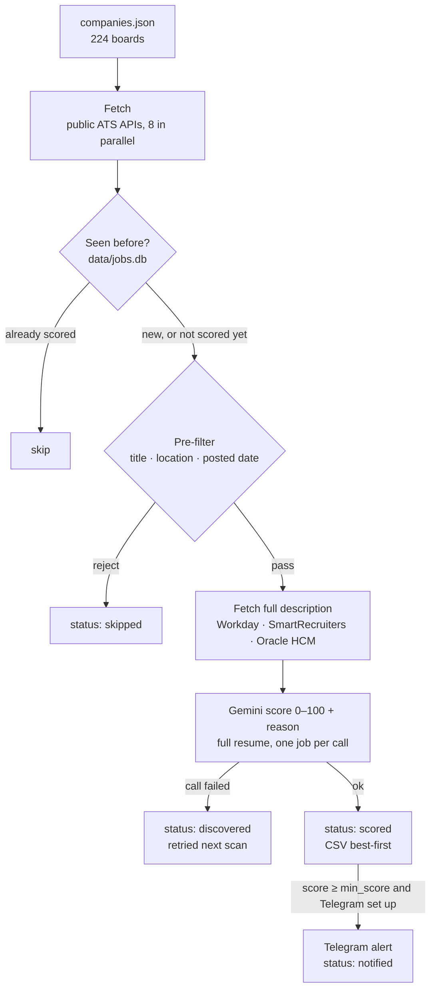

# RoleSight

[](https://github.com/Manish814142/rolesight/actions/workflows/ci.yml)
[](LICENSE)
[](https://www.python.org/)

**An AI job radar.** Every day it pulls open roles straight from the public job APIs of 224
company boards hiring in India, drops the ones that obviously don't fit, has Google Gemini score
the rest against your resume, and writes the matches to a CSV, best first.

The defaults are one profile's: 3 years of experience in Node.js, backend and distributed systems,
looking in India or for genuinely remote roles. That profile is the worked example. The
[user guide](docs/00-user-guide.md) lists the few files and settings to change for yours (candidate
profile, title and location rules, resume), and the company list is a starting point so you don't
begin from scratch.

> 🔒 **Drafts only — it never applies.** Nothing in this project submits an application
> or fills in a form. It finds and ranks jobs; you decide and apply yourself.

RoleSight started from [autopilot-jobhunt](https://github.com/tarunlnmiit/autopilot-jobhunt) by Tarun Gupta (MIT)
and has been largely rewritten since: see [Credits and license](#credits-and-license). It is not on PyPI; install it
from a clone ([Quick start](#quick-start)).

---

## Contents

- [What it does](#what-it-does)
- [Features](#features)
- [How it works](#how-it-works)
- [Current status](#current-status)
- [Quick start](#quick-start)
- [Commands](#commands)
- [Configuration](#configuration)
- [Outputs](#outputs)
- [The company list](#the-company-list)
- [Project layout](#project-layout)
- [Documentation](#documentation)
- [Development](#development)
- [Third-party text](#third-party-text)
- [Credits and license](#credits-and-license)

---

## What it does

Each scan (`autopilot scan`):

1. **Fetches** every open job from each company's applicant-tracking system (Greenhouse,
   Lever, Workday, …) through its public JSON API. No browser, no scraping of careers pages.
2. **Filters locally**, with no network or AI: role title, India or remote location, and
   optionally how recently the job was posted.
3. **Fetches the full job description** for the jobs that survived, where the list API
   didn't include one.
4. **Scores** each survivor with Gemini, from 0 to 100, against the full resume and the
   candidate profile, with a one-sentence reason.
5. **Remembers** every job in SQLite, so the next scan only scores jobs it hasn't seen.
6. **Writes** a CSV (`output/jobs_YYYY-MM-DD.csv`), best score first. If Telegram is
   configured, it also sends alerts.

What you do with it: open the CSV, read the top rows, apply to the ones that fit through
the company's own job page.

---

## Features

| Area | What you get |
|---|---|
| **Direct ATS APIs** | Adapters for Greenhouse (US and EU), Lever, Ashby, SmartRecruiters, Workday, Oracle HCM, Eightfold, Phenom, Amazon Jobs, Workable, Recruitee and Personio. Parallel fetching (8 workers) with a hard time limit on every request, so one slow board can't stall a scan. |
| **Curated company list** | `companies.json`: 224 boards, each checked to be live, to belong to the right employer and to have India jobs. `autopilot discover` adds companies from a pasted list in any format and applies the same checks. |
| **Local pre-filter** | Word-bounded title rules (backend / Node.js / SDE / software engineer in, plus generic "Senior Engineer" titles; staff / lead / manager / other stacks out), location rules (all of India or remote from India, or only the cities you list in `candidate.cities`), and an optional "posted within N days" window. |
| **Full descriptions** | For Workday, SmartRecruiters, Oracle HCM and Eightfold, whose list APIs carry little or no description, the full text is fetched for survivors only, just before scoring. |
| **Resume-aware scoring** | Gemini reads the whole resume, the candidate profile and the whole job description. It returns a score and one sentence explaining it. One job per call, by design: batching measurably inflated scores. |
| **Seen-job memory** | `data/jobs.db` (SQLite) records every job's status. A job is scored once; scoring failures are retried on the next scan; pre-filter rejections are re-checked each scan, so filter fixes apply to old jobs too. |
| **Outputs** | A CSV per scan (never overwritten), `autopilot export` for filtered CSVs, optional Telegram alerts, and an MCP server for driving it from Claude Code. |
| **Maintenance tools** | `autopilot doctor` (environment checks), `discover --recheck` (find dead or migrated boards), `discover --census` (which ATS does a careers page use?). |
| **Safety** | Drafts only. API keys, config and the real resume are gitignored. Tests never touch the network. |

---

## How it works



**A full production run** (2026-10-12, 224 boards, 7-day window, `min_score` 70; measured from `data/scan.log`, the
database and the CSV it wrote; 145 jobs from an earlier run were already scored):

| Stage | Result |
|---|---|
| Fetch all boards | 5.0 min, 33,652 jobs, 17,104 of them in India |
| Rejected by the pre-filter | 31,920 |
| Passed the filter but posted more than 7 days ago | 1,310 |
| Full descriptions fetched | 70 s |
| Gemini scoring | 317 jobs in 39.3 min (316 on `gemini-3.5-flash-lite`, 1 on the fallback model; 0 failed) |
| Total | 48.5 min |
| Scores | 60 of the 317 at 70 or above, 29 at 85 or above |

A later scan only scores jobs it has not seen, so it should be shorter. That is *inferred*; no repeat run has
been measured yet.

---

## Current status

As of 2026-10-13. The live list of work is the task board, [docs/tasks.md](docs/tasks.md).

**Working**
- Fetching, the pre-filter, the posted-date window, description enrichment, scoring, the CSV and the seen-job
  memory, as in the run above.
- `discover` for adding companies, `doctor`, `export`, `mark`, `draft`.
- One database row per posting, keyed by its ATS id, so separate openings with the same title are all scored.
- A job that disappears from its board is marked closed after three scans without it.

**Known gaps** (each is a task on the board)
- **Not scheduled by default.** Scans run by hand. `scripts/systemd/install.sh` installs a daily systemd user
  timer when you choose.
- **Telegram is unverified.** The last send attempts (2026-10-03) failed with HTTP 404, so treat Telegram as off.
  The CSV is the primary output.
- **Scores vary a little between runs.** On the 20 hardest labelled jobs, 5 runs each at the default temperature:
  2 had a spread over 20 points and 2-3 crossed `min_score`. Temperature 0 does not fix it. With the T73 rubric (the
  current one adds a rule for AI titles, T74), two runs of all 82 labelled jobs changed no pass/fail decision at 60 or 70.
- **Coarse scores.** Many jobs tie at 90, so the order inside the top band is arbitrary; breaking ties needs sub-scores
  (opt-in, `scoring_mode: structured`). All but one of the 82 labels behind these measurements were made by Claude,
  not by a human, and are not yet confirmed (T59), so treat the figures as indicative.
- **The outside-India rule sometimes caps a job in an Indian city** (T79).

---

## Quick start

Full walkthrough: [docs/01-install.md](docs/01-install.md).

```bash
# 1. Install (Python 3.11+); run from the repo root
python3 -m venv .venv && source .venv/bin/activate
pip install -e '.[dev]'                 # google-genai (Gemini) is a core dependency

# 2. Configure
cp config.example.json config.json      # edit the candidate profile (see docs/07)
cp job_hunt/data/env_example .env       # set GEMINI_API_KEY (free: aistudio.google.com/apikey)
cp resume/YOUR_RESUME.md resume/me.md   # replace with your resume; set candidate.resume_path

# 3. Check the environment
autopilot doctor

# 4. First scan: limit it to recent jobs to stay inside Gemini's free daily quota
autopilot scan --posted-within 7

# 5. Read the results
ls output/                              # jobs_YYYY-MM-DD.csv, best score first
```

In this repo `companies.json` (224 boards) is already in place. `autopilot init`, for a pip install in an
empty directory, copies the same curated list.

---

## Commands

All commands run from the repo root (they read `config.json`, `companies.json` and
`.env` from the current directory). `python -m job_hunt <command>` works the same as
`autopilot <command>`.

| Command | What it does | Needs keys? |
|---|---|---|
| `autopilot scan` | Full scan: fetch → filter → score → CSV | Gemini |
| `autopilot scan --limit 5` | Only the first 5 companies in `companies.json` | Gemini |
| `autopilot scan --posted-within 3` | One run with a 3-day window (`all` = none). The default window is `max_posted_age_days`, 7; undated jobs are kept | Gemini |
| `./run_daily.sh [args]` | Runs `scan` with each output line timestamped into `data/scan.log` | Gemini |
| `autopilot export [--min N] [--days N]` | Writes a CSV from the last scan, or from N days of history, keeping jobs with score ≥ N | none |
| `autopilot discover --add-file paste.txt --merge companies.json` | Verifies pasted company names and adds the ones that pass ([docs/04](docs/04-companies-and-scanning.md)) | none |
| `autopilot discover --recheck --merge companies.json` | Re-verifies every board; repairs or removes dead ones | none |
| `autopilot discover --census FILE` | Identifies which ATS each careers page uses | none |
| `autopilot doctor` | Checks the SQLite write, a 1-token Gemini call, Telegram `getMe` and ATS reachability | Gemini (Telegram optional) |
| `autopilot draft N \| URL` | Drafts a tailored resume and cover letter for job N of the last scan | stored description + LLM (`--jd-file` for a pasted one) |
| `autopilot mark N \| URL applied\|interview\|rejected\|offer` | Records where your application stands, with today's date (`none` clears it); `export` shows it | none |
| `autopilot mcp` | Starts the MCP server for Claude Code ([docs/06](docs/06-mcp-and-skill.md)) | as per tool |
| `autopilot harvest` / `validate` | Older list builders. Don't point them at the curated list ([docs/04](docs/04-companies-and-scanning.md)) | none |

---

## Configuration

Two local, gitignored files:

| File | Holds |
|---|---|
| `config.json` | Candidate profile (`name`, `resume_path`, `profile`, `seeking`, `not_suitable`, `min_score`, `top_n`, `max_posted_age_days`), `llm_provider`, `gemini_model`, optional `telegram`, `fetch_workers`, `gemini_scoring_mode` |
| `.env` | API keys (`GEMINI_API_KEY`, optional `TELEGRAM_TOKEN` / `TELEGRAM_CHAT_ID`), plus overrides such as `MIN_SCORE`, `RESUME_PATH`, `GEMINI_MODEL` |

A value in `.env` overrides `config.json`, unless it is a template placeholder
(`YOUR_…`, `…_here`). It also overrides variables already exported in your shell.
The full reference is in [docs/07-config-and-scoring.md](docs/07-config-and-scoring.md).

The **pre-filter rules are hardcoded** in `job_hunt/prefilter.py` on purpose: they are tuned to one
profile, so edit them for yours ([the guide](docs/00-user-guide.md) lists the patterns).
`python scripts/check_filter.py "Java Developer" "Pune, India"` shows what the filter does with one job.

---

## Outputs

| Path | Contents |
|---|---|
| `output/jobs_YYYY-MM-DD.csv` | One file per scan (`_1`, `_2`, … if one already exists). Columns: Company, Role, Location, Posted, Application URL, LinkedIn people, Score (%), Reason, Worth Applying, Scan Date (plus Stack, Stack fit, Role fit, … only when a scorer provides them, and Model when a model other than the primary scored some job). Best score first. |
| `output/open_matches.csv` | Rewritten every scan: jobs ≥ `min_score` you haven't marked (`autopilot mark`), inside the posted-date window, best first |
| `data/jobs.db` | SQLite seen-job memory: `skipped` → `discovered` → `scored` / `notified` |
| `state/*.json` | Retired (T34): no longer written or read; `scripts/import_json_history.py` imports what only they hold |
| `data/autopilot.log` | Full DEBUG log of every run; rotates at 5 MB, 3 older files kept |
| `data/scan.log` | Timestamped console output of `run_daily.sh` runs |

Details, including what each DB status means: [docs/05-outputs-and-notifications.md](docs/05-outputs-and-notifications.md).

---

## The company list

`companies.json` is the core of the project, and it is **curated**:

| ATS | Boards |
|---|---|
| Workday | 82 |
| Greenhouse | 74 |
| Lever | 23 |
| Ashby | 20 |
| SmartRecruiters | 13 |
| Eightfold | 4 |
| Oracle HCM | 4 |
| Workable | 2 |
| Amazon Jobs | 1 |
| Phenom | 1 |
| **Total** | **224** (counted 2026-10-13) |

To add companies, paste their names into a file in any format and run
`autopilot discover --add-file paste.txt --report /tmp/r.csv --out /tmp/v.json --merge companies.json`.
A board is accepted only if it has live jobs, belongs to that employer, has at least one
India job, and has a posting from the last 180 days.

Companies on custom career portals (Google, Flipkart, Swiggy's own site, Darwinbox,
Zoho Recruit, …) can't be reached. See [docs/04](docs/04-companies-and-scanning.md).

---

## Project layout

```
job_hunt/
  adapters/         one fetcher per ATS + detect_ats(), fetch_company_jobs(), enrich_job()
  scanner.py        run_scan(): the whole pipeline
  prefilter.py      title / location / posted-date rules (personal, hardcoded)
  scorer.py         Gemini scoring per job, DB status updates, per-job Telegram alert
  llm_utils.py      LLM providers (gemini default; anthropic, claude_cli)
  db.py, models.py  SQLite seen-job store; JobPosting + dedupe hash
  exporter.py       CSV writer (never overwrites)
  discovery.py      `discover`: verify and add companies, recheck, census
  harvester.py, validator.py, company_builder.py   older list builders
  doctor.py         `doctor` diagnostics
  drafter.py        `draft` (resume + cover letter drafts)
  notifier.py       Telegram
  tools.py, mcp_server.py   MCP server for Claude Code
  main.py           CLI and config loading
companies.json      the curated board list (committed)
scripts/            company_seeds.txt, careers_urls.txt (discover inputs)
run_daily.sh        daily runner (timestamps into data/scan.log)
docs/               guides + the task board (docs/tasks.md)
tests/              pytest suite, no network
```

The design: [ARCHITECTURE.md](ARCHITECTURE.md).

---

## Documentation

| Doc | Read it for |
|---|---|
| [docs/00 — User guide](docs/00-user-guide.md) | **Start here to change something:** which file and which setting, step by step |
| [docs/01 — Install & first run](docs/01-install.md) | Setup from zero to the first CSV |
| [docs/02 — LLM providers](docs/02-providers.md) | Gemini (default), Anthropic, Claude CLI; quotas |
| [docs/03 — API keys](docs/03-api-keys.md) | Which keys exist, which are needed, where they go |
| [docs/04 — Companies & scanning](docs/04-companies-and-scanning.md) | `companies.json`, adding companies, what a scan does, timings |
| [docs/05 — Outputs & notifications](docs/05-outputs-and-notifications.md) | CSV, DB statuses, state files, logs, export, Telegram, drafts |
| [docs/06 — MCP server & skill](docs/06-mcp-and-skill.md) | Driving it from Claude Code |
| [docs/07 — Config & scoring](docs/07-config-and-scoring.md) | Every config key; the pre-filter and scoring in detail |
| [docs/08 — Troubleshooting](docs/08-troubleshooting.md) | Known errors and fixes |
| [docs/09 — Testing checklist](docs/09-testing-checklist.md) | Gates and smoke tests |
| [docs/tasks.md](docs/tasks.md) | The task board: what's pending, in review and done |
| [ARCHITECTURE.md](ARCHITECTURE.md) | Components, data flow, rules, limitations |
| [CHANGELOG.md](CHANGELOG.md) | What changed, with measurements |
| [SECURITY.md](SECURITY.md) · [PRIVACY.md](PRIVACY.md) | Guarantees, and what data leaves the machine |
| [CONTRIBUTING.md](CONTRIBUTING.md) | How work is picked up (people and AI agents) |

---

## Development

```bash
pip install -e '.[dev]'
pytest                 # coverage gate 85%
ruff check job_hunt/ tests/ conftest.py   # the paths CI lints
mypy
```

- **Tests never touch the network.** Stub the adapters, Gemini and Telegram.
- **Work comes from the board.** Pick, claim, implement and hand over through
  [docs/tasks.md](docs/tasks.md). See [CONTRIBUTING.md](CONTRIBUTING.md).
- **Record changes** in [CHANGELOG.md](CHANGELOG.md) under `[Unreleased]`, with the
  measurement that justifies them.

---

## Third-party text

`scripts/golden_set.csv` and `scripts/golden_set_ai.csv` hold the text of public job postings, copied only to evaluate the
scoring rubric (each row is a posting with a hand-given label; see [docs/07](docs/07-config-and-scoring.md)). The text belongs
to the companies that posted it. If you represent one of them and want a posting removed, open an issue and it will be removed.

---

## Credits and license

RoleSight started from [autopilot-jobhunt](https://github.com/tarunlnmiit/autopilot-jobhunt) by
[@tarunlnmiit](https://github.com/tarunlnmiit) (MIT). Parts of its MCP server, drafting, Telegram and CLI code are
still here. The original crawled company careers pages through TinyFish and scored with OpenRouter; both were removed.
Added or rewritten since: the direct ATS adapters, the local pre-filter, the SQLite seen-job memory, the Gemini
scoring with its rubric and labelled test set, the company discovery tooling, the user guide and most of the tests.
Released under the MIT licence; the original copyright notice stays in [LICENSE](LICENSE).
